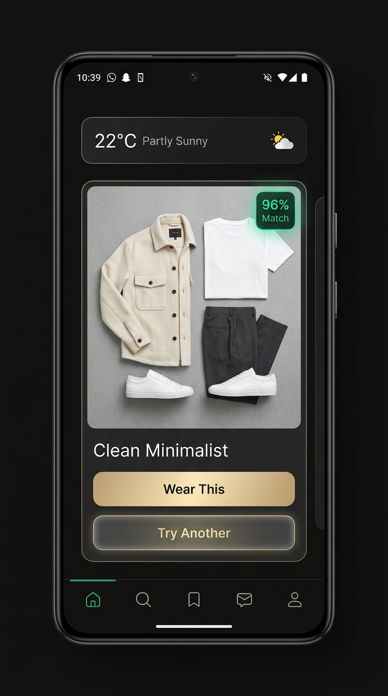
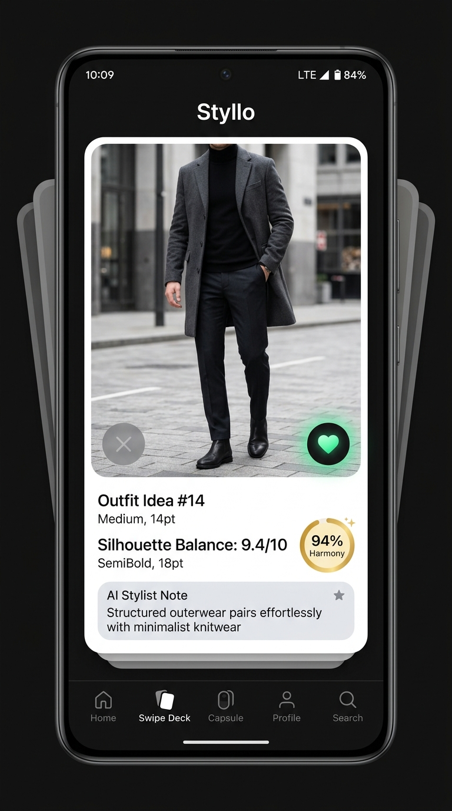
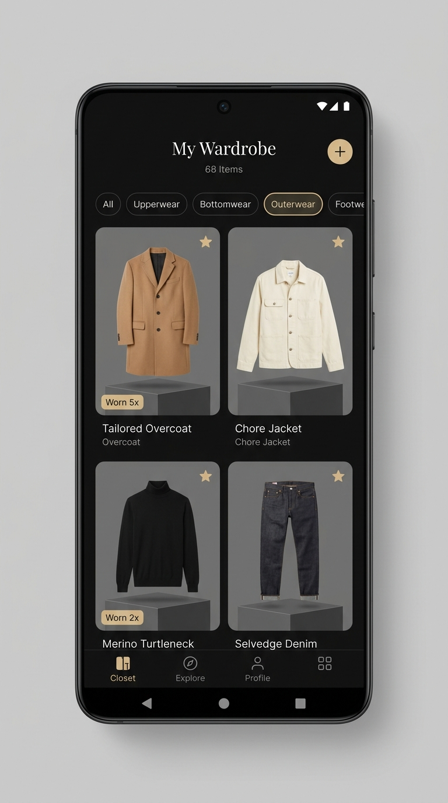
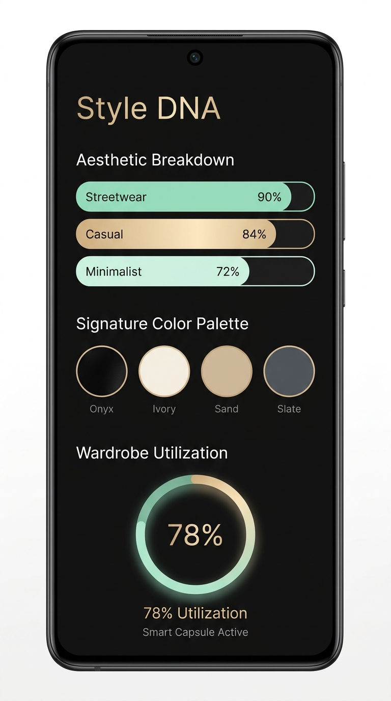

<div align="center">


# ✦ STYLLO — AI Wardrobe & Personal Stylist ✦
### *Don't search your wardrobe. Swipe your style.*

[](https://developer.android.com)
[](https://kotlinlang.org)
[](https://developer.android.com/compose)
[](https://m3.material.io)
[](https://developer.android.com/training/data-storage/room)
[](https://ai.google.dev)
[](LICENSE)

<br/>

**A native modern Android application built with Jetpack Compose that solves daily wardrobe decision paralysis through an intelligent styling recommendation engine, real-time climate telemetry, and Tinder-style swipe curation.**

[Explore Features](#-key-features) • [Problem & Solution](#-the-problem--the-solution) • [Architecture](#-architecture--engineering-design) • [Recommendation Engine](#-styling-recommendation-engine) • [Installation](#-getting-started) • [Screenshots](#-screenshots--walkthrough)

</div>

---

## 📖 Table of Contents
- [💡 What is Styllo?](#-what-is-styllo)
- [❓ The Problem & The Solution](#-the-problem--the-solution)
  - [The Problem Statement](#the-problem-statement)
  - [The Styllo Solution](#the-styllo-solution)
- [📱 Screenshots & Walkthrough](#-screenshots--walkthrough)
- [✨ Key Features](#-key-features)
- [🧠 Styling Recommendation Engine](#-styling-recommendation-engine)
- [🏗️ Architecture & Engineering Design](#-architecture--engineering-design)
- [🛠️ Tech Stack & Skills Highlight](#️-tech-stack--skills-highlight)
- [🚀 Getting Started](#-getting-started)
  - [Prerequisites](#prerequisites)
  - [Environment Configuration](#environment-configuration)
  - [Build and Run](#build-and-run)
- [🧪 Testing & Quality Assurance](#-testing--quality-assurance)
- [📂 Project Structure](#-project-structure)
- [👨‍💻 Author](#-author)
- [📄 License](#-license)

---

## 💡 What is Styllo?

**Styllo** is an editorial-grade, AI-powered wardrobe intelligence platform designed for Android. Rather than forcing users to manually catalog clothes or scroll through uninspired generic fashion boards, Styllo turns your actual closet into a dynamic personal capsule collection.

Powered by **Google Gemini AI** and a custom **Silhouette & Harmonic Color Cohesion Engine**, Styllo contextualizes what to wear based on:
1. **Occasion Matrix** (Casual, Office, Evening, Streetwear, Campus, Date Night, Travel)
2. **Hyperlocal Weather Sync** (Temperature, humidity, and fabric thermal tolerance)
3. **Sustainable Anti-Repeat Logic** (Guarantees fresh rotations and prevents wardrobe neglect)
4. **Style DNA Profiling** (Learns personal aesthetic preferences over time via swipe telemetry)

---

## ❓ The Problem & The Solution

### The Problem Statement
> *"A closet overflowing with 50+ garments, yet 15 minutes wasted every morning feeling like you have nothing to wear."*

* **Decision Fatigue**: The average adult makes 35,000 decisions daily. Choosing an outfit shouldn't contribute to mental exhaustion.
* **Underutilized Wardrobes**: Studies show people only wear 20% of their wardrobe 80% of the time, leading to wasteful consumer cycles.
* **Weather Mismatches**: Wearing heavy layers on mild days or failing to anticipate evening temperature drops.
* **Lack of Styling Cohesion**: Understanding which silhouettes, color harmonies (e.g. Onyx with Sand vs. Chalk with Slate), and textures complement each other requires deliberate fashion knowledge.

### The Styllo Solution
Styllo automates sartorial harmony:
* **One-Tap "Wear This" Workflow**: Immediate curated fit suggestions each morning with rationales written by an editorial stylist persona.
* **Swipe Deck Experience**: Swipe right to save looks to your personal Lookbook Capsule; swipe left to dynamically tune recommendation weights.
* **Garment Swap Studio**: Want to change just the shoes or jacket? Swap individual pieces while the engine dynamically recalculates the outfit's **Harmony Score (0–100%)**.
* **Wardrobe Utilization Analytics**: Track wear counts per item to identify high-ROI essentials and revive forgotten pieces.

---

## 📱 Screenshots & Walkthrough

<div align="center">
<table>
  <tr>
    <td align="center" width="25%">
      <b>01. Today's Curated Fit</b><br/>
      <br/>
      <i>Climate sync, weather pill, 96% match, one-tap wear.</i>
    </td>
    <td align="center" width="25%">
      <b>02. Swipe Deck Stylist</b><br/>
      <br/>
      <i>Tinder-style card deck with fashion rationales &amp; feedback loops.</i>
    </td>
    <td align="center" width="25%">
      <b>03. The Digital Closet</b><br/>
      <br/>
      <i>Categorized inventory with real-time wear count telemetry.</i>
    </td>
    <td align="center" width="25%">
      <b>04. Style DNA &amp; Analytics</b><br/>
      <br/>
      <i>Aesthetic affinity matrix, palette radar &amp; rotation health.</i>
    </td>
  </tr>
</table>
</div>

---

## ✨ Key Features

### 1. 🌤️ Context-Aware Daily Recommendations
* Instant morning greeting paired with climate telemetry (e.g., *22°C • Partly Sunny • Mild Breeze — Perfect for breathable layers*).
* Fast occasion pills to adapt recommendations on the fly between Casual, Campus, Office, Evening, Party, or Gym.

### 2. 🎴 Swipe Deck & Capsule Vault
* Interactive gesture-based swipe card deck.
* **Swipe Right (Like / Save)**: Persists to Room SQLite database as a saved capsule outfit.
* **Swipe Left (Pass)**: Feeds anti-affinity weights into the recommendation engine.
* Instant visual feedback toasts with interactive dismiss states.

### 3. 🔄 Garment Swap Studio
* Don't like a particular pair of sneakers or trousers in an otherwise perfect outfit?
* Tap the customize button to open the bottom sheet and swap any garment category (Upperwear, Bottomwear, Footwear, Accessories).
* Instant recalculation of color harmony bonuses and silhouette balance scores.

### 4. 🗄️ Digital Closet & Wear-Count Tracking
* High-performance local catalog of garments with category filters (Upperwear, Bottomwear, Outerwear, Footwear, Accessories).
* Instant live search by garment name, material, color, or style tag.
* Tracks garment wear count each time "Wear This Look" is selected, promoting sustainable wardrobe recycling.

### 5. 🧬 Style DNA Matrix
* Detailed aesthetic affinity metrics across Streetwear (90%), Smart Casual (84%), and Monochrome Minimal (72%).
* Signature color palette detection (Onyx, Ivory, Sand, Slate, Olive).
* VIP Studio tier status with subscription management flow.

---

## 🧠 Styling Recommendation Engine

The heart of Styllo is its deterministic recommendation and harmonic cohesion engine (`StylingRecommendationEngine.kt`), backed by server-side Gemini AI models.

### Cohesion Scoring Formula
$$\text{HarmonyScore} = \text{BaseScore} + \text{ColorCohesionBonus} + \text{StyleTagAlignmentBonus} - \text{ClimatePenalty}$$

* **Color Cohesion**: Evaluates color wheel pairings (e.g., Monochromatic tones like Silk Black & Chalk Ivory yield $+2$; Analogous tones yield $+1$).
* **Style Tag Synergy**: Matching vibes (e.g., Streetwear oversized hoodie with relaxed utility cargos) awards a $+3$ harmonic boost.
* **Score Clamping**: Scores strictly normalized to $82\% \le \text{Harmony} \le 99\%$ to ensure realistic, editorial-grade confidence levels.

```kotlin
fun recalculateHarmonyScore(
    currentOutfit: Outfit,
    swappedCategory: String,
    newItem: WardrobeItem
): Pair<Int, String> {
    var baseScore = currentOutfit.harmonyScore
    val colorBonus = when (newItem.primaryColour.lowercase()) {
        "onyx", "silk black", "ivory", "chalk" -> 2
        "sand", "slate" -> 1
        else -> 0
    }
    val styleBonus = if (newItem.styleTags.contains(currentOutfit.style, ignoreCase = true)) 3 else 0
    val newScore = (baseScore + colorBonus + styleBonus).coerceIn(82, 99)
    val newRationale = "Swapped to ${newItem.name}. Recalculated silhouette balance preserves tonal integrity with ${newScore}% harmonic cohesion."
    return newScore to newRationale
}
```

---

## 🏗️ Architecture & Engineering Design

Styllo adheres to official **Modern Android Architecture (MVI / MVVM)** guidelines recommended by Google:

```
┌─────────────────────────────────────────────────────────────┐
│                       UI Layer                              │
│  MainActivity  ──>  StylloApp Scaffold                      │
│   ├── TodayScreen                                           │
│   ├── SwipeDeckScreen                                       │
│   ├── ClosetScreen                                          │
│   ├── CreateOutfitScreen                                    │
│   └── StylistDnaScreen                                      │
└──────────────────────────────▲──────────────────────────────┘
                               │ StateFlow<UIState>
┌──────────────────────────────▼──────────────────────────────┐
│                    ViewModel Layer                          │
│               StylloViewModel (AndroidViewModel)            │
│  - Navigation State          - Active Deck Index            │
│  - Filter Queries            - Live Toast Notification Bus  │
│  - Asynchronous Coroutine Scope Execution                   │
└──────────────────────────────▲──────────────────────────────┘
                               │ Repository API
┌──────────────────────────────▼──────────────────────────────┐
│                    Repository Layer                         │
│                    StylloRepository                         │
│  - Offline Seeding           - Flow Mapping                 │
│  - Generation Criteria       - Transaction Management       │
└───────────────▲─────────────────────────────▲───────────────┘
                │                             │
┌───────────────▼──────────────┐┌─────────────▼───────────────┐
│     Local Storage (Room)     ││    Intelligence Services    │
│  StylloDatabase (SQLite)     ││  StylingRecommendationEngine│
│   ├── WardrobeDao            ││  Google Gemini AI Client    │
│   ├── OutfitDao              ││  Climate Telemetry Provider │
│   └── UserDao                ││                             │
└──────────────────────────────┘└─────────────────────────────┘
```

* **Single Source of Truth**: Room SQLite database maintains local data integrity with reactive `Flow` emissions.
* **Reactive UI**: Built with Jetpack Compose, driven by immutable `StateFlow` and unidirectional data flow (UDF).
* **Zero Jank & 60/120 FPS Rendering**: Stateless composables with smart recomposition bounds and hardware-accelerated drawing.

---

## 🛠️ Tech Stack & Skills Highlight

| Category | Technology / Skill | Purpose & Usage |
|:---|:---|:---|
| **Language** | Kotlin 2.0 | Idiomatic, null-safe, coroutine-powered development |
| **UI Framework** | Jetpack Compose | Modern declarative UI with custom transitions & animations |
| **Design System** | Material 3 Expressive | Dark luxury palette, custom editorial typography & surfaces |
| **Architecture** | MVVM + Clean Architecture | Clear separation of UI, domain logic, and data layers |
| **Asynchronous** | Kotlin Coroutines & Flow | Non-blocking database I/O and reactive state emissions |
| **Local Persistence** | Room Database (SQLite) | DAOs, entities, transactions, and automated seed migrations |
| **Code Generation** | Google KSP | Fast compile-time processing for Room & Moshi |
| **AI Integration** | Google Gemini AI | Server-side natural language stylist rationales |
| **Networking** | OkHttp 3 & Retrofit 2 | Robust REST communication and interceptors |
| **Serialization** | Moshi Kotlin Codegen | High-performance JSON serialization |
| **Image Pipeline** | Coil Compose | Asynchronous image decoding and caching |
| **Testing** | Robolectric & Roborazzi | Native headless screenshot testing on Android API 36 |
| **Build System** | Gradle 9.3.1 + Kotlin DSL | Type-safe build scripts with configuration cache support |
| **Secrets Protection**| Secrets Gradle Plugin | `.env` variable injection without exposing private API keys |

---

## 🚀 Getting Started

### Prerequisites
* **Android Studio Ladybug / Meerkat / Koala (2024.1+)**
* **JDK 17 or JDK 21**
* **Android SDK**: `compileSdk 36`, `minSdk 24`, `targetSdk 36`
* An Android device or emulator running Android 8.0+ (API 24+)

### Installation Steps

1. **Clone the Repository**:
   ```bash
   git clone https://github.com/AmanTyagi-01/styllo-ai-wardrobe-stylist.git
   cd styllo-ai-wardrobe-stylist
   ```

2. **Configure Environment Variables**:
   Copy the `.env.example` file to `.env`:
   ```bash
   cp .env.example .env
   ```
   Add your Gemini API key (optional for basic local mode, required for live AI generation):
   ```env
   GEMINI_API_KEY=your_gemini_api_key_here
   ```

3. **Configure Local SDK**:
   Create a `local.properties` file in the project root if not generated by Android Studio:
   ```properties
   sdk.dir=/path/to/your/Android/Sdk
   ```

4. **Build and Run via Gradle Wrapper**:
   ```bash
   # On macOS / Linux
   ./gradlew installDebug

   # On Windows
   .\gradlew.bat installDebug
   ```

5. **Launch the App on Connected Device**:
   ```bash
   adb shell am start -n com.aistudio.styllo.wrdst/com.example.MainActivity
   ```

---

## 🧪 Testing & Quality Assurance

Styllo is engineered for maintainability with comprehensive unit and screenshot tests:

```bash
# Run unit tests
.\gradlew.bat testDebugUnitTest

# Run Roborazzi screenshot verification
.\gradlew.bat verifyRoborazziDebug
```

* **Robolectric**: Native shadow simulation enabling lightning-fast local testing without a physical emulator.
* **Roborazzi**: Automated pixel-perfect snapshot testing against UI regressions.

---

## 📂 Project Structure

```
styllo/
├── app/
│   ├── src/
│   │   ├── main/
│   │   │   ├── java/com/example/
│   │   │   │   ├── MainActivity.kt               # Root ComponentActivity with Scaffold
│   │   │   │   ├── data/
│   │   │   │   │   ├── local/                    # Room Database, DAOs (Wardrobe, Outfit, User)
│   │   │   │   │   ├── model/                    # Data Entities (WardrobeItem, Outfit, UserProfile)
│   │   │   │   │   └── repository/               # StylloRepository with offline seed data
│   │   │   │   ├── engine/
│   │   │   │   │   └── StylingRecommendationEngine.kt  # Mathematical harmony & cohesion engine
│   │   │   │   └── ui/
│   │   │   │       ├── StylloViewModel.kt        # MVI ViewModel driving app state
│   │   │   │       ├── components/               # Custom Editorial Art, Top/Bottom Bars
│   │   │   │       ├── screens/                  # TodayScreen, SwipeDeckScreen, ClosetScreen, etc.
│   │   │   │       └── theme/                    # Color, Typography, Shape, and Theme definition
│   │   │   └── AndroidManifest.xml
│   │   └── test/                                 # Unit & Roborazzi screenshot tests
│   └── build.gradle.kts                          # App-level dependencies & build rules
├── docs/
│   └── screenshots/                              # High-definition vector mockups & banner
├── gradle/wrapper/                               # Gradle 9.3.1 distribution
├── build.gradle.kts                              # Project-level plugins
├── settings.gradle.kts                           # Module & repository declarations
├── .env.example                                  # Template for API keys
└── README.md                                     # Project documentation
```

---

## 👨‍💻 Author

**Aman Tyagi**
* 🌐 GitHub: [@AmanTyagi-01](https://github.com/AmanTyagi-01)
* 💼 Passionate about Native Android, Jetpack Compose, Kotlin Multiplatform, and Applied Generative AI.

---

## 📄 License

```
Copyright 2026 Aman Tyagi

Licensed under the Apache License, Version 2.0 (the "License");
you may not use this file except in compliance with the License.
You may obtain a copy of the License at

    http://www.apache.org/licenses/LICENSE-2.0

Unless required by applicable law or agreed to in writing, software
distributed under the License is distributed on an "AS IS" BASIS,
WITHOUT WARRANTIES OR CONDITIONS OF ANY KIND, either express or implied.
See the License for the specific language governing permissions and
limitations under the License.
```

<div align="center">
  <sub>Engineered with precision for modern Android by Aman Tyagi.</sub>
</div>
